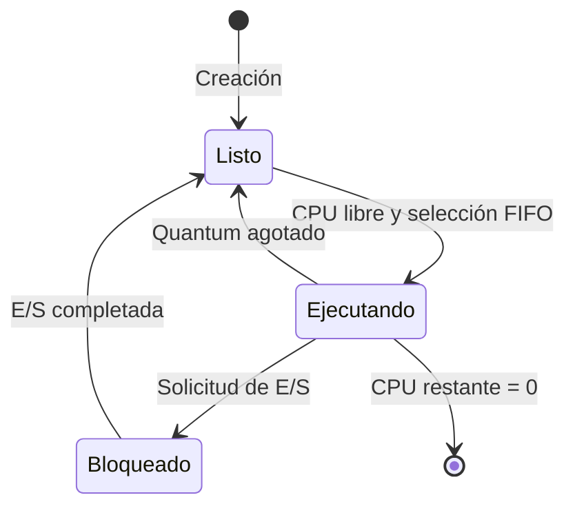

# Análisis técnico del simulador de estados de procesos

### 1. Resumen técnico del proyecto

El proyecto es un simulador educativo de una CPU y tres estados de procesos: Listo (`ready`), Ejecutando (`running`) y Bloqueado (`blocked`). Implementa Round Robin con cola FIFO y quantum configurable de 1 a 8 ticks, inicialmente 3.

Dispone de ejecución automática mediante reloj y modo manual con controles de CPU y E/S. Incluye generación de procesos, métricas acumuladas, registro de eventos y Gantt limitado a los últimos 24 ticks.

La lógica está separada de la interfaz: [`src/simulation.ts`](src/simulation.ts) contiene el motor; [`src/keyboard.ts`](src/keyboard.ts), la traducción de atajos; y [`src/App.tsx`](src/App.tsx), la visualización y los controles.

**El lenguaje principal es TypeScript, con React; no Python**, lo que contradice el objetivo indicado en la plantilla universitaria.

El análisis se basa en el código actual y en pruebas ejecutadas. No se modificó el código fuente ni se generaron otros documentos.

### 2. Funciones core y arquitectura

Las funciones del motor están en [`src/simulation.ts`](src/simulation.ts).

| Función | Propósito | Ubicación | Comportamiento relevante |
|---|---|---|---|
| `createRandomProcess()` | Crear procesos | [`src/simulation.ts:26`](src/simulation.ts#L26) | Añade un proceso Listo; respeta el máximo de 15 activos. |
| `resetSimulation()` | Inicializar sesión | [`src/simulation.ts:39`](src/simulation.ts#L39) | Genera 5–8 procesos; restablece tiempo, métricas y quantum. |
| `transitionProcess()` | Cambiar estado y orden | [`src/simulation.ts:47`](src/simulation.ts#L47) | Mueve el proceso al final del arreglo y reinicia su quantum consumido. |
| `scheduleNextProcess()` | Despachar CPU | [`src/simulation.ts:54`](src/simulation.ts#L54) | Selecciona el primer Listo únicamente si no existe otro Ejecutando. |
| `advanceSimulation()` | Ejecutar un intervalo | [`src/simulation.ts:71`](src/simulation.ts#L71) | Actualiza CPU, E/S según modo, finalización, quantum, eventos y Gantt. |
| `setSimulationMode()` | Cambiar modalidad | [`src/simulation.ts:112`](src/simulation.ts#L112) | Conserva procesos y métricas; pausa el reloj. |
| `requestProcessIO()` | Solicitar E/S manual | [`src/simulation.ts:116`](src/simulation.ts#L116) | Bloquea al proceso Ejecutando y asigna un dispositivo aleatorio. |
| `completeProcessIO()` | Completar E/S manual | [`src/simulation.ts:128`](src/simulation.ts#L128) | Devuelve un PID bloqueado a Listo, sin despacharlo. |
| `simulationReducer()` | Centralizar acciones | [`src/simulation.ts:143`](src/simulation.ts#L143) | Procesa reloj, controles, modos y finalización de E/S por posición. |
| `handleKeyboardCommand()` | Traducir pulsaciones | [`src/keyboard.ts:4`](src/keyboard.ts#L4) | Produce acciones; descarta repetición, composición y ciertos modificadores. |

El estado único contiene procesos, configuración, contadores, semilla y registros. El arreglo de procesos contiene los tres estados; **no existen tres colas independientes**. El orden relativo de sus elementos Listos representa la cola FIFO. El avance copia los procesos antes de modificarlos.

### 3. Modelo de estados y planificación

**Representación del proceso.** Cada proceso tiene PID, nombre, estado, CPU total y restante, tick de llegada, quantum consumido, punto programado de E/S, duración y tiempo pendiente de E/S. El tipo de dispositivo es opcional.

**Transiciones implementadas:**

| Transición | Condición |
|---|---|
| Listo → Ejecutando | CPU libre y proceso situado primero entre los Listos. |
| Ejecutando → Listo | Quantum consumido alcanza el configurado, sin finalizar ni bloquearse. |
| Ejecutando → Bloqueado | Solicitud manual con `I` o llegada al punto programado de E/S en automático. |
| Bloqueado → Listo | Finalización manual de E/S o contador automático de E/S igual a cero. |
| Ejecutando → salida | CPU restante llega a cero; se retira el proceso y aumenta `completed`. |

**Round Robin está implementado:** los procesos expropiados regresan al final de Lista. El quantum aumenta únicamente al consumir CPU. La prioridad de evaluación es **finalización → E/S automática → agotamiento del quantum**.

**Modo automático:**

- Intervalo de reloj: `1000 / speed` milisegundos.
- CPU y operaciones previamente bloqueadas avanzan en el mismo tick.
- Una E/S recién solicitada empieza a descontarse en el siguiente.
- Puede despachar al terminar el tick; ese nuevo proceso ejecutará en el siguiente intervalo.

**Modo manual:**

- Espacio ejecuta exactamente un tick, despachando primero si hace falta.
- `I` solicita E/S; `1–9` completa la operación de la tarjeta correspondiente.
- `N` crea un proceso; `R` reinicia conservando el modo manual.
- No avanzan contadores de E/S ni se producen llegadas o bloqueos programados.
- Solicitar o completar E/S no consume ticks.
- Existen botones equivalentes, incluso para más de nueve bloqueados.
- Los atajos excluyen campos editables; Espacio sobre un botón conserva su activación nativa.

Cambiar de modo conserva los datos y pausa la simulación. Al reanudar el automático, las E/S recuperan su cuenta pendiente.

**Generación:** CPU de 4–18 ticks; probabilidad de E/S programada del 55 %; bloqueo de 2–5 ticks. La autogeneración opcional intenta añadir un proceso cada tres ticks con probabilidad del 60 %. La aleatoriedad usa una semilla reproducible, aunque la interfaz la inicializa con la hora actual.

### 4. Procedimiento verificable

Estos pasos reconstruyen responsabilidades técnicas presentes; **no prueban su orden histórico de desarrollo**.

1. **Preparación:** configuración verificable de Vite, React, TypeScript y ESLint en [`package.json`](package.json) y archivos de configuración.
2. **Modelo:** definición de procesos, estados, sesión y generación seudorrandómica en `simulation.ts`.
3. **Planificación:** implementación de selección FIFO, quantum, bloqueo, reincorporación y finalización.
4. **Visualización:** tarjetas por estado, controles, métricas y registros en `App.tsx`; estilos oscuros y adaptativos en los archivos CSS.
5. **Automatización:** intervalo de reloj con limpieza, velocidades y autogeneración opcional.
6. **Control manual:** acciones compartidas del reducer, E/S por intervención y listener de teclado con limpieza.
7. **Validación:** pruebas existentes del motor y teclado; en esta revisión se ejecutaron `npm test` y `npm run lint`, ambos correctamente.

### 5. Resultados demostrables

**Confirmados por inspección:**

- Una CPU, tres estados y planificación Round Robin.
- Métricas de activos, Listos, Bloqueados, finalizados, tick y utilización.
- Utilización calculada como `busyTicks / tick × 100`, redondeada.
- Gantt con PID o `IDLE` durante los últimos 24 ticks.
- Historial limitado a 10 eventos.
- Finalizados retirados del conjunto activo; no existe una lista completa persistente de ellos.

**Evidencia ejecutada:** `npm test` terminó correctamente para los dos archivos de pruebas. Sus casos cubren quantum, E/S, finalización, inactividad, pausa, inmutabilidad, cambio de modo y comandos. Incluyen 30 sesiones automáticas de 400 ticks con comprobación de invariantes. ESLint también terminó sin errores. Esto no equivale a una prueba visual en navegador.

**Cuatro capturas recomendadas:**

Preparación: iniciar con `npm run dev`, seleccionar modo manual y reiniciar. Para usar Espacio, colocar el foco fuera de botones y campos.

| Captura | Estado y acción | Evidencia técnica |
|---|---|---|
| 1. Listo y Ejecutando | Presionar Espacio una vez. | Primer despacho, reducción de CPU restante y coexistencia de un Ejecutando con varios Listos. |
| 2. Solicitud de E/S | Desde la anterior, presionar `I`. | El mismo PID aparece Bloqueado; CPU libre y dispositivo pendiente. |
| 3. Retorno a Listo | Presionar Espacio para ejecutar otro proceso y luego `1`. | El bloqueado vuelve a Lista; el otro conserva la CPU. |
| 4. Quantum y finalización | Continuar con Espacio, sin nuevas solicitudes de E/S. Capturar inmediatamente después de una finalización. | Gantt con turnos, contador de finalizados y evento `FIN`; anotar previamente la devolución a Lista tras consumir tres ticks. |

La secuencia reproduce las transiciones; nombres, dispositivos y duración total varían entre reinicios.

### 6. Diagrama de estados

La finalización es una salida del ciclo. En automático, Bloqueado → Listo y Listo → Ejecutando pueden ocurrir dentro de una misma llamada al motor, pero son operaciones distintas.

### 7. Información para el análisis crítico

1. **¿Por qué no pasa directamente de Bloqueado a Ejecutando?**  
   Completar E/S solo elimina la condición de espera: `completeProcessIO()` lo devuelve a Lista. La CPU se asigna mediante `scheduleNextProcess()`, respetando disponibilidad y orden FIFO. En automático, ambas transiciones pueden suceder en un mismo tick.

2. **¿Qué pasaría si no se respetara el quantum?**  
   La condición `quantumUsed >= quantum` provoca la devolución a Lista. Sin ella, el proceso conservaría la CPU hasta finalizar o bloquearse, retrasando a los demás. El simulador dejaría de realizar la rotación Round Robin prevista.

3. **¿Cómo se relaciona Bloqueado con E/S?**  
   Los procesos bloqueados no reducen su CPU restante. Esperan un contador en automático o una intervención en manual. Teclado, disco, red e impresora son representaciones simuladas; no se ejecutan operaciones reales sobre esos dispositivos.

4. **¿Qué diferencia existe entre expropiación y bloqueo voluntario?**  
   El agotamiento del quantum representa expropiación: el proceso sigue siendo ejecutable y vuelve a Lista. La solicitud de E/S representa bloqueo: abandona la CPU y no puede ejecutarse hasta completar la operación.

5. **¿Qué proceso tuvo más cambios de contexto y por qué?**  
   **No hay información suficiente para identificarlo.** El proyecto no acumula cambios de contexto por PID ni conserva una traza completa.

   - **Despacho:** asignación de CPU registrada como evento `CPU`.
   - **Cambio de estado:** cualquier transición; completar E/S no implica necesariamente cambiar el ocupante de CPU.
   - **Cambio de contexto:** transferencia entre procesos; no se modelan guardado de registros ni su coste. Despachar nuevamente el mismo PID no demuestra un cambio entre procesos distintos.

   Para obtener evidencia válida, ejecutar el motor con una semilla fija, quantum fijo y autogeneración desactivada; registrar externamente cada tick y despacho antes de que los historiales se recorten. Definir como criterio, por ejemplo, transferencias entre PIDs distintos, contabilizando por separado los intervalos `IDLE`. Después se podrá identificar el PID con más participaciones y relacionarlas con su CPU requerida y sus bloqueos. Este experimento no se realizó en esta revisión.

### 8. Recursos utilizados

Confirmados en [`package.json`](package.json) y el código:

- **Lenguajes:** TypeScript/TSX, JavaScript en pruebas y configuración, HTML y CSS.
- **Interfaz:** React y React DOM, declarados como `^19.2.8`.
- **Desarrollo y compilación:** Vite `^8.3.0`, plugin de React y TypeScript `~6.0.2`.
- **Iconos:** Lucide React `^1.57.0`.
- **Análisis estático:** ESLint y complementos de TypeScript y React.
- **Pruebas:** módulos nativos `node:test` y `node:assert/strict`.
- **Entorno consultado:** Node.js `v26.10.0` y npm `12.2.0`.
- **Ejecución de la interfaz:** navegador con DOM; no se verificó un navegador concreto.

Las versiones precedidas por `^` o `~` son rangos declarados, no versiones instaladas comprobadas. No se requieren backend, base de datos ni API externa.

### 9. Hallazgos para discusión y conclusiones

1. **La política FIFO con devolución al final implementa la rotación Round Robin.** El quantum determina cuánto puede ejecutar cada proceso por turno.
2. **CPU y E/S avanzan por separado.** Bloquear un proceso libera la CPU y permite ejecutar otro mientras la E/S permanece pendiente.
3. **Completar E/S recupera elegibilidad, no prioridad inmediata.** El proceso vuelve al final de Lista.
4. **Ambos modos comparten el motor.** Cambian el origen del avance y las reglas de E/S, conservando el mismo planificador.
5. **Las métricas describen un modelo simplificado.** No incluyen coste de cambios de contexto; los registros limitados permiten observar actividad reciente, pero no reconstruir una ejecución completa.

### 10. Información pendiente

- **Datos informativos:** institución, estudiante, docente, curso, fecha y demás campos personales de la plantilla.
- **Discrepancia obligatoria:** el objetivo que menciona Python debe aclararse; la implementación real utiliza TypeScript y React.
- **Capturas:** obtener las cuatro evidencias propuestas y anotar los PIDs, quantum y acciones de la sesión real.
- **Verificación visual:** comprobar teclado, foco, botones, animaciones y presentación adaptable en un navegador; las pruebas ejecutadas cubren lógica, no interacción DOM completa.
- **Resultado experimental:** obtener la traza necesaria para responder qué PID participó en más cambios de contexto y declarar el criterio utilizado.
- **Bibliografía:** seleccionar y verificar fuentes académicas para Round Robin, estados y E/S; el código inspeccionado sustenta la implementación, no sustituye esas referencias.
- **Cronología:** si el procedimiento exige fechas u orden histórico, deberán aportarse registros de desarrollo; la estructura actual no los acredita.
